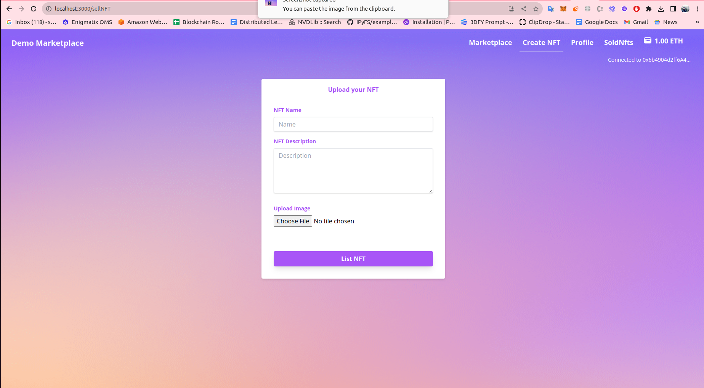
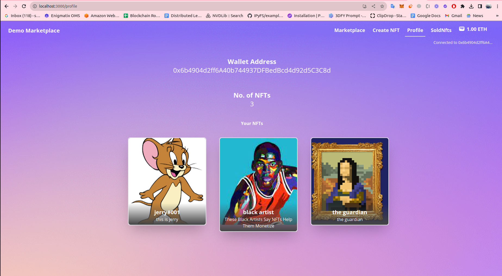
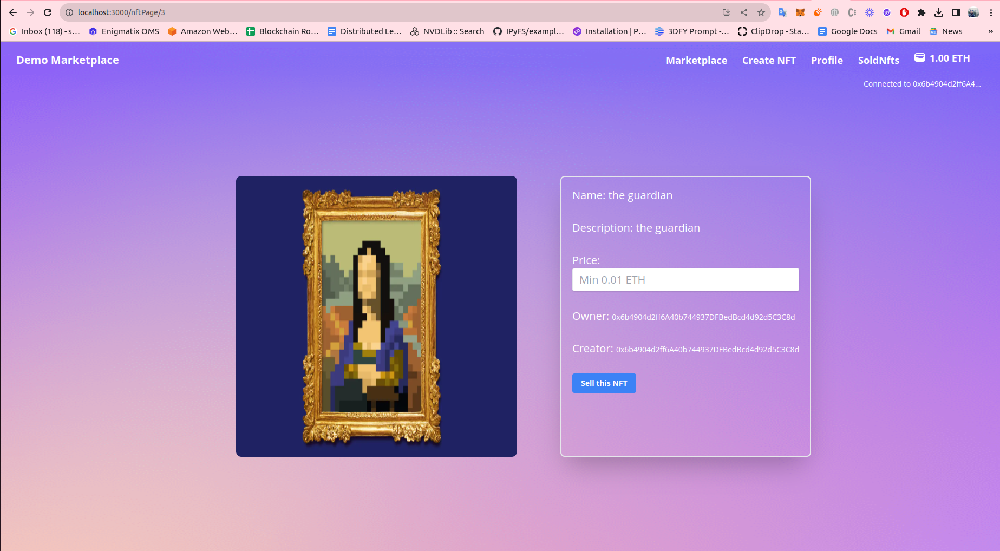
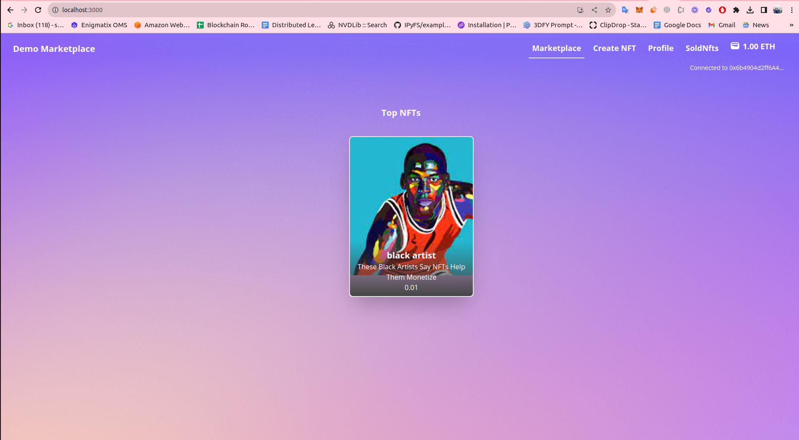

# Basic NFT Marketplace end to end

### Screenshots







To set up the repository and run the marketplace locally, run the below
```bash
git clone https://github.com/shahbaz004/nft_marketplace_FE.git
cd nft_marketplace_FE
npm install
npm start
```